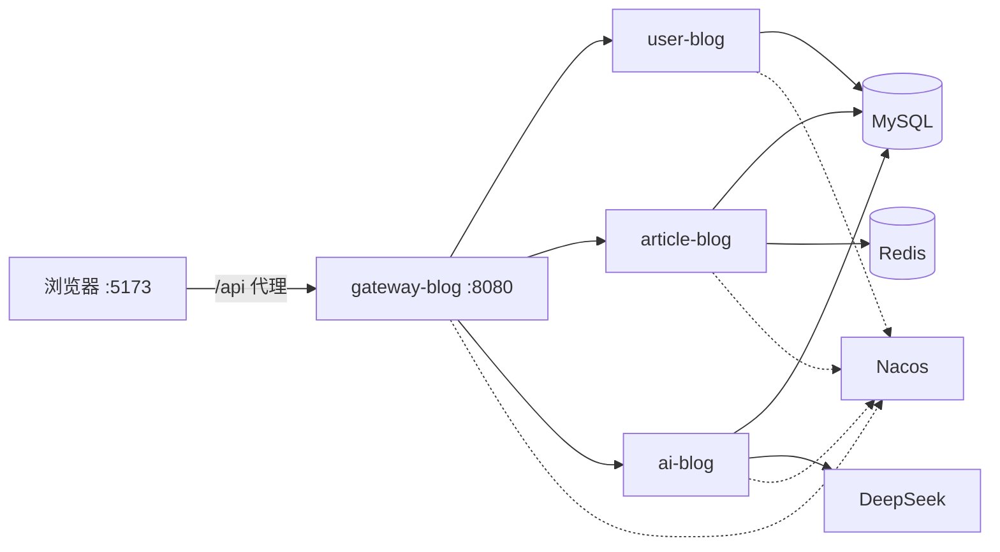

# 蓝水晶博客

个人博客系统：写文章、管分类、评论点赞，并用 **Spring AI ChatClient + DeepSeek** 按关键词检索技术知识、写入数据库后可反复查阅。

仓库：[lsj-lsj54/lan-shui-jing-blog](https://github.com/lsj-lsj54/lan-shui-jing-blog)（前后端合一，本仓库保留）

分离后的独立仓库：

- 前端：[lsj-lsj54/lan-shui-jing-blog-frontend](https://github.com/lsj-lsj54/lan-shui-jing-blog-frontend)
- 后端：[lsj-lsj54/lan-shui-jing-blog-backend](https://github.com/lsj-lsj54/lan-shui-jing-blog-backend)

## 功能

- **账号**：注册、登录（JWT + BCrypt）、个人资料
- **文章**：Markdown 编辑、分类、标签、分页搜索、浏览量、点赞、评论、历史版本回滚
- **知识库**：输入关键词（如 `ChatClient.prompt() 的作用`），调用 DeepSeek 生成结构化说明并落库；相同关键词默认读库，可强制重新生成

## 技术栈

| 层 | 技术 |
|----|------|
| 前端 | Vue 3、Vite、Vue Router、Element Plus、md-editor-v3、Axios |
| 网关 | Spring Cloud Gateway、JWT 鉴权、CORS |
| 服务 | Spring Boot 3.5、Spring Cloud 2025、Spring Cloud Alibaba 2025、Nacos、MyBatis-Plus |
| AI | Spring AI 1.1、`spring-ai-starter-model-deepseek`、ChatClient |
| 数据 | MySQL 8（`blog_user` / `blog_article` / `blog_ai`）、Redis（浏览量计数） |

## 架构



浏览器只访问网关。网关去掉 `/api` 前缀后按路径转发，校验 JWT 并把 `user-id`、`username` 传给下游。

## 仓库结构

```
frontend/                 Vue 3 前端
backend/                  Maven 多模块后端
  common-blog/            统一返回、异常、JWT、MyBatis-Plus 填充
  gateway-blog/           网关：鉴权、路由、跨域
  user-blog/              用户与登录
  article-blog/           文章、分类、评论、点赞、版本
  ai-blog/                对话与知识库
  sql/                    建表与升级脚本
.env.example              环境变量示例（不要提交真实 Key）
docker-compose.yml        一键启动：MySQL / Redis / Nacos / 微服务 / 前端
docker/                   后端、前端 Dockerfile 与 Nginx 配置
```

## 环境要求

- JDK 17、Maven 3.8+、Node.js 18+
- MySQL 8、Redis、Nacos 2.x（默认 `192.168.175.128:8848`）
- DeepSeek API Key：[platform.deepseek.com](https://platform.deepseek.com)

端口与数据源以 **Nacos 配置** 为准。本地约定：网关 `8080`，`ai-blog` `8083`。用户服务、文章服务的端口写在 Nacos 的 `user-blog.yaml`、`article-blog.yaml` 中。

## 快速开始

### 1. 数据库

全新环境：

```bash
mysql -u root -p < backend/sql/init_schema.sql
```

已有库、只需知识表：

```bash
mysql -u root -p < backend/sql/upgrade_ai_knowledge.sql
```

会创建三个库：`blog_user`、`blog_article`、`blog_ai`。各服务数据源建议放在 Nacos，不要把密码提交进 Git。

### 2. Nacos

各模块 `bootstrap.yml` 已指向 `192.168.175.128:8848`。请在 Nacos 准备对应 Data ID（`yaml`、`public`、`DEFAULT_GROUP`）：

| Data ID | 至少包含 |
|---------|----------|
| `user-blog.yaml` | 端口、数据源 `blog_user`、JWT（可与本地 `application.yml` 互补） |
| `article-blog.yaml` | 端口、数据源 `blog_article` |
| `ai-blog.yaml` | 数据源 `blog_ai`；DeepSeek Key 也可写在这里 |
| `gateway-blog.yaml` | 若配置了路由，注意不要与本地 `application.yml` 冲突 |

Nacos 示例（按实际改地址和密码）：

```yaml
server:
  port: 8081   # user-blog 示例，文章服务另设端口

spring:
  datasource:
    url: jdbc:mysql://127.0.0.1:3306/blog_user?useUnicode=true&characterEncoding=utf8&serverTimezone=Asia/Shanghai
    username: root
    password: your_password
    driver-class-name: com.mysql.cj.jdbc.Driver
```

### 3. DeepSeek

**不要把 Key 提交进仓库。**

```powershell
# Windows PowerShell
$env:DEEPSEEK_API_KEY="sk-..."
```

```bash
# Linux / macOS
export DEEPSEEK_API_KEY=sk-...
```

也可在 Nacos `ai-blog.yaml`：

```yaml
spring:
  ai:
    deepseek:
      api-key: ${DEEPSEEK_API_KEY}
      chat:
        options:
          model: deepseek-chat
          temperature: 0.3
```

未配置 Key 时，知识检索和对话会返回「未配置 DeepSeek API Key」，页面仍可打开。

### 4. 启动后端

```bash
cd backend
mvn -pl common-blog,user-blog,article-blog,ai-blog,gateway-blog -am package -DskipTests
```

顺序：Nacos / MySQL / Redis → `user-blog` → `article-blog` → `ai-blog` → `gateway-blog`。

在 IDE 中分别运行各模块的 `*Application` 即可。

### 5. 启动前端

```bash
cd frontend
npm install
npm run dev
```

开发地址一般为 `http://localhost:5173`（占用时 Vite 会换端口）。`/api` 代理到 `http://localhost:8080`。

## Docker 一键启动

需要本机已安装 Docker 与 Docker Compose。首次构建后端镜像会下载 Maven 依赖，耗时较长。

```bash
cp .env.example .env
# 编辑 .env，填入 DEEPSEEK_API_KEY（知识库需要；不填也能先起服务）

docker compose up -d --build
```

| 地址 | 说明 |
|------|------|
| http://localhost | 前端（Nginx 反代 `/api` 到网关） |
| http://localhost:8080 | 网关 |
| http://localhost:8848/nacos | Nacos 控制台（已关闭登录） |
| 3306 / 6379 | MySQL / Redis |

常用命令：

```bash
docker compose ps
docker compose logs -f gateway-blog
docker compose down          # 停容器，保留数据卷
docker compose down -v       # 停容器并清空 MySQL / Redis 数据
```

容器内 Nacos 只做服务发现；数据源、Redis、JWT 由 Compose 环境变量注入，不再读取 Nacos 配置（`NACOS_CONFIG_ENABLED=false`）。初始化 SQL 会在 MySQL 首次启动时自动执行。

## 前端页面

| 路径 | 说明 | 登录 |
|------|------|------|
| `/login` | 登录 / 注册 | 否 |
| `/` | 文章列表、分类、搜索 | 是 |
| `/article/:id` | 文章详情、点赞、评论 | 否（写操作需登录） |
| `/publish`、`/publish/:id` | 发布 / 编辑 | 是 |
| `/profile` | 个人中心 | 是 |
| `/knowledge` | 知识库检索与沉淀列表 | 是 |

请求头：`Authorization: Bearer {token}`。`code === 1` 为成功；`401` 会跳转登录页。知识检索超时 120 秒。

## 网关

本地默认路由：

| 前缀 | 服务 |
|------|------|
| `/api/user/**` | user-blog |
| `/api/article/**` | article-blog |
| `/api/ai/**` | ai-blog |

大模型调用超时：连接 5 秒，响应 120 秒。

无需登录即可访问：

- `POST /api/user/login`、`POST /api/user/register`
- `GET /api/article/page`、`GET /api/article/{数字id}`
- `GET /api/article/comment/list/{articleId}`
- `GET /api/article/category/list`

其余接口需要有效 Token。网关与用户服务的 `jwt.secret` 必须一致。

## 接口一览

统一响应：`{ "code": 1, "msg": "...", "data": ... }`。`code = 1` 成功，`0` 失败。

路径均带网关前缀 `/api`。

### 用户 `/api/user`

| 方法 | 路径 | 登录 | 说明 |
|------|------|------|------|
| POST | `/login` | 否 | 返回 `{ token, user }` |
| POST | `/register` | 否 | 注册 |
| GET | `/{id}` | 是 | 用户信息（无密码） |
| GET | `/username/{username}` | 是 | 按用户名查 |
| GET | `/page` | 是 | 分页 |
| POST | `/` | 是 | 新增 |
| PUT | `/` | 是 | 修改 |
| DELETE | `/{id}` | 是 | 删除 |

### 文章 `/api/article`

| 方法 | 路径 | 登录 | 说明 |
|------|------|------|------|
| GET | `/page` | 否 | 分页，支持关键词、分类 |
| GET | `/{id}` | 否 | 详情，浏览量 Redis 计数 |
| GET | `/user/{userId}` | 是 | 某用户文章 |
| POST | `/` | 是 | 发布 |
| PUT | `/` | 是 | 修改并记版本 |
| DELETE | `/{id}` | 是 | 删除 |
| GET | `/version/list/{articleId}` | 是 | 版本列表 |
| POST | `/version/rollback/{versionId}` | 是 | 回滚 |
| POST | `/like/{articleId}` | 是 | 点赞切换 |
| GET | `/category/list` | 否 | 分类 |
| POST | `/category` | 是 | 新增分类 |
| DELETE | `/category/{id}` | 是 | 删除分类 |
| GET | `/comment/list/{articleId}` | 否 | 评论分页 |
| POST | `/comment/add` | 是 | 评论 |
| DELETE | `/comment/{id}` | 是 | 删评论 |

### 知识库 `/api/ai/knowledge`（需登录）

| 方法 | 路径 | 说明 |
|------|------|------|
| POST | `/search` | 检索：库中有则返回，否则调 DeepSeek 后写入 |
| GET | `/page` | 已沉淀知识分页 |
| GET | `/{id}` | 详情 |
| DELETE | `/{id}` | 删除 |

`POST /search` 请求体：

```json
{
  "keyword": "ChatClient.prompt() 的作用",
  "forceRefresh": false
}
```

`forceRefresh: true` 会重新生成并覆盖。关键词会规范化（去首尾空白、压缩空格、转小写）后作为唯一键。

### 对话 `/api/ai/message`（需登录）

| 方法 | 路径 | 说明 |
|------|------|------|
| POST | `/` | 保存用户消息，调用 DeepSeek，再保存助手回复 |
| GET | `/user/{userId}` | 对话历史 |
| GET | `/page` | 分页 |
| GET | `/{id}` | 单条 |
| PUT | `/` | 修改 |
| DELETE | `/{id}` | 删除 |

`POST /` 请求体：`{ "content": "你好" }`。返回 `{ userMessage, assistantMessage }`。

## 数据库

| 库 | 主要表 |
|----|--------|
| `blog_user` | `t_user` |
| `blog_article` | `t_article`、`t_article_like`、`t_article_version`、`t_category`、`t_comment` |
| `blog_ai` | `t_ai_message`、`t_ai_knowledge` |

索引升级（老库若缺唯一索引）：`backend/sql/upgrade_indexes.sql`。

浏览量走 Redis `INCR`，文章服务定时落库，需保证 Redis 可用。

## 安全注意

- 生产环境务必更换 `jwt.secret`，网关与用户服务保持一致
- 密码为 BCrypt；历史明文密码无法直接登录，需重置
- Redis、数据源、DeepSeek Key 只放环境变量或 Nacos，不要提交

## 常见问题

**服务起不来 / 注册不上 Nacos**  
确认 `192.168.175.128:8848` 可达，或改各模块 `bootstrap.yml` 里的 `server-addr`。

**前端接口 404**  
网关是否在 `8080`，Nacos 里是否用另一套路由覆盖了本地配置。

**知识检索失败**  
是否设置 `DEEPSEEK_API_KEY`；网关超时是否为 120 秒；`blog_ai.t_ai_knowledge` 是否已建表。

**登录 401**  
Token 过期（默认 24 小时），或两边 JWT 密钥不一致。
